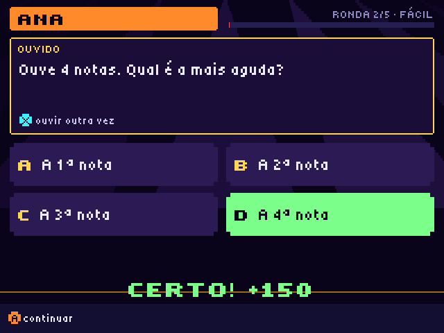

# ORIMBUX MOTHERSHIP

**Uma nave-mãe de 12 apps de música e jogos para a consola portátil R36S (ArkOS / dArkOS).**
Também corre no PC. Escrita em Python + SDL2, com a interface em português.


| | | |
|---|---|---|
|  |  |  |
| A ponte: missões e as 12 apps | Beat Forge: caixa de ritmos | Void Runner: a tua música é o nível |
|  |  | |
| Som de Ouro: quiz até 10 jogadores | Beat Duel frente a frente | |

## Download

Vai a **[Releases](../../releases/latest)**:

| Ficheiro | Para quê |
|---|---|
| `OrimbuxMothership_v1.9.1.zip` | Consola R36S (ArkOS / dArkOS). O conteúdo da pasta `ports` vai para a pasta `ports` do cartão. |
| `OrimbuxMothership_PC_Windows_v1.9.1.zip` | Windows: abre e faz duplo clique em `Orimbux Mothership (PC).bat`. |
| `orimbux_trailer_v191.mp4` | Trailer (1 min 18 s), com imagens reais das apps. |
| `orimbux_creditos_v191.mp4` | Créditos. |

## As 12 apps

**Música**, um caminho do ritmo à mistura. Toda a nave toca no mesmo BPM.

1. **PULSAR**: o tempo (BPM) e o metrónomo, com tap tempo.
2. **BEAT FORGE**: caixa de ritmos com grelha de 8 pistas, construtor por estilo e arranjo.
3. **ABDUCTOR**: grava a voz (micro USB) ou corta músicas em fatias para tocar.
4. **LOOP REACTOR**: 8 pads de loops sempre no compasso.
5. **XENO SYNTH**: sintetizador em escala, sem notas erradas.
6. **VOX NEBULA**: a tua voz com efeitos ao vivo.
7. **TWIN DECKS**: dois decks com crossfader, como um DJ.
8. **WARP FLOOR**: leitor de música com visuais.

**Jogos**

- **XENO PET**: um bicho alien que cresce contigo, em tempo real.
- **SOM DE OURO**: quiz de música com 345 perguntas em 4 níveis. Modo FESTA para 2 a 10 jogadores.
- **VOID RUNNER**: a tua música é o nível (ao estilo do Beat Hazard). Os drops trazem hordas e baús, e O GRAVE, um subwoofer gigante, puxa-te aos poucos.
- **BEAT DUEL**: jogo de ritmo a dois, também frente a frente na mesma consola deitada.

Há ainda trailer, créditos, cinco ambientes de música na intro, missões para quem está a começar e uma ajuda em todas as apps (segurar SELECT). O manual completo está em [`LEIA-ME.txt`](LEIA-ME.txt).

## Instalar na R36S

1. Desliga a consola e tira o cartão SD das ROMs (o que tem a pasta `ports`).
2. Copia `Orimbux Mothership.sh` e a pasta `mothership` (de `ports/` no zip) para a pasta `ports` do cartão.
3. Volta a pôr o cartão, liga a consola e reinicia o EmulationStation.
4. Abre **Ports > Orimbux Mothership**.

## Correr no PC

- **Windows:** usa o zip PC da Release. Precisa do Python 3 (python.org). Na primeira vez instala `pysdl2-dll` sozinho.
- **Linux / macOS:** a partir deste repositório:

```bash
pip install pysdl2-dll            # SDL2; em Python >= 3.13 também: pip install audioop-lts
python3 ports/mothership/main.py
```

Teclado: setas = cruz, Z/X/S/A = A/B/X/Y, Q/W = L1/R1, Enter = START, Backspace = SELECT, F11 = ecrã inteiro. Comandos Xbox também funcionam.

## Para investigar o código

```
ports/
  Orimbux Mothership.sh   lançador do ArkOS (instala os zips, corre main.py)
  mothership/
    main.py               ponto de entrada
    engine.py             gráficos (SDL2, 640x480), fontes, mistura de áudio em tempo real, entrada
    app.py                a ponte, as secções de música e a navegação
    ui.py, help.py        componentes da interface e textos de ajuda
    forge.py, chop.py, decks.py, vox.py, ...   uma app por ficheiro
    voidrunner.py, songscan.py   o jogo e a análise da música (intensidade, batidas, drops)
    quiz.py, quizbank.py  o Som de Ouro e o banco de perguntas
    trailer.py, credits.py   o trailer e os créditos (desenhados em tempo real)
    lib/sdl2/             pysdl2, incluído para a consola
    assets/               sons, músicas, pixel art (.frm), fontes
tools/
  build_*.py              geram os assets: sons, músicas, fontes, arte, trailer
  render_trailer.py       grava o trailer/créditos em MP4 (precisa do ffmpeg)
  package.py              faz os zips da release
  *_test.py               testes headless (SDL_VIDEODRIVER=dummy)
  pc/                     lançador para Windows
```

- Sem dependências pesadas na consola: só Python 3, SDL2 e `audioop`.
- Os assets estão no repositório já gerados. As ferramentas em `tools/` usam `numpy` e `Pillow`.
- Testes: `python3 tools/v19_test.py /tmp/out`, `python3 tools/vr_test.py /tmp/out 0` (um bot joga o Void Runner), etc.

## Licença

- **Código:** MIT (ver [`LICENSE`](LICENSE)).
- **Samples:** da biblioteca do Sonic Pi, todos CC0, incluindo os doados por Arovane e The Black Dog.
- **Letra:** Tiny5, SIL Open Font License.
- Detalhes em [`CREDITS.md`](CREDITS.md).

---

### English

ORIMBUX MOTHERSHIP is a set of 12 music and game apps for the R36S handheld (ArkOS), written in Python + SDL2. It also runs on a PC. The UI is in Portuguese.

- **Music:** tempo, drum machine, sampler/slicer, loop pads, synth, voice FX, two DJ decks and a player.
- **Games:** a virtual pet, a music quiz for up to 10 players, a Beat Hazard-like shooter driven by your own song, and a two-player rhythm duel.
- **Download:** see [Releases](../../releases/latest).
- **Code:** MIT. Samples are CC0 (Sonic Pi library), the font is Tiny5 (OFL).
