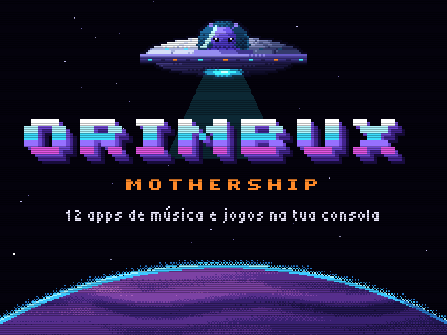
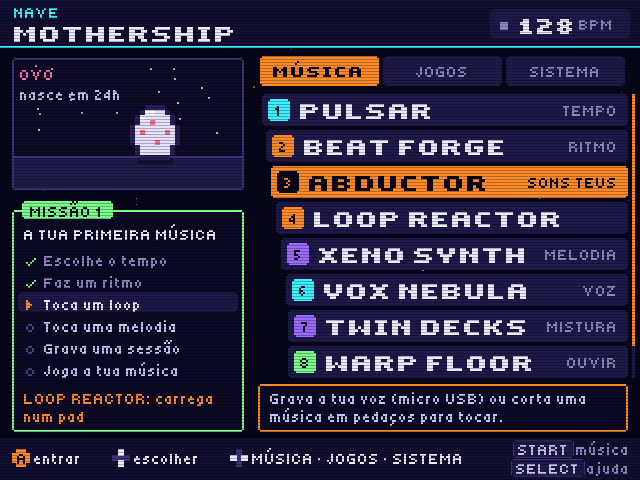
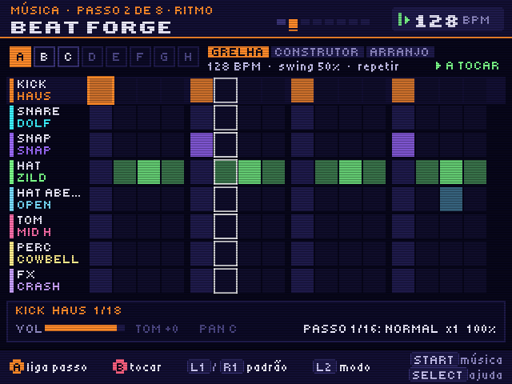
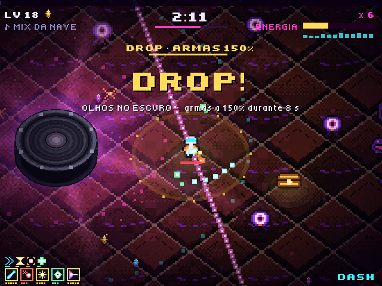
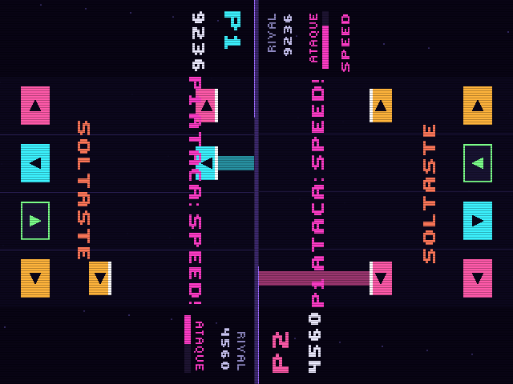
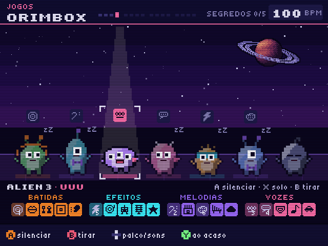

# ORIMBUX MOTHERSHIP

**Uma nave-mãe de 13 apps de música e jogos para a consola portátil R36S (ArkOS / dArkOS).**
Também corre no PC. Escrita em Python + SDL2, com a interface em português.



| | | |
|---|---|---|
|  |  |  |
| A ponte: missões e as 13 apps | Beat Forge: caixa de ritmos | Void Runner: a tua música é o nível |
|  |  |  |
| Disco Voador: quiz até 10 jogadores | Beat Duel frente a frente | ORIMBOX: uma tripulação alien que canta |

## Download

**[⬇ Descarregar tudo (ZIP)](https://github.com/GiuseppeLomb/Orimbux-Mothership-R36S/archive/refs/heads/main.zip)**, ou em cima: *Code > Download ZIP*.

O zip traz a app pronta a usar:
- **Consola R36S:** a pasta `ports/` tem tudo o que vai para o cartão (ver *Instalar na R36S*).
- **Windows:** faz duplo clique em `Orimbux Mothership (PC).bat` (ver *Correr no PC*).

**[⬇ Versão PC para Windows (ZIP, 97 MB)](https://github.com/GiuseppeLomb/Orimbux-Mothership-R36S/releases/download/v1.11-pc/OrimbuxMothership_v1.11_PC_Windows.zip)**: um `Orimbux Mothership.exe` que não precisa de Python nem de instalação (também em *Releases*, ver *Correr no PC*). É a v1.11, ainda sem o ORIMBOX: o ZIP de cima já o tem.

Vídeos: [trailer (1 min 18 s)](docs/video/trailer.mp4) com imagens reais das apps, e [créditos](docs/video/creditos.mp4). Áudio: [uma mistura do ORIMBOX](docs/audio/orimbox_demo.m4a).

## As 13 apps

**Música**, um caminho do ritmo à mistura. Toda a nave toca no mesmo BPM.

1. **PULSAR**: o tempo (BPM) e o metrónomo, com tap tempo.
2. **BEAT FORGE**: caixa de ritmos com grelha de 8 pistas, construtor por estilo e arranjo.
3. **ABDUCTOR**: grava a voz (micro USB) ou corta músicas em fatias para tocar.
4. **LOOP REACTOR**: 8 pads de loops sempre no compasso, em 13 bancos (de HIP HOP, LATINO e ÉPICO a ROCK).
5. **XENO SYNTH**: sintetizador em escala, sem notas erradas.
6. **VOX NEBULA**: a tua voz com efeitos ao vivo.
7. **TWIN DECKS**: dois decks com crossfader, como um DJ.
8. **WARP FLOOR**: leitor de música com visuais.

**As tuas músicas** aparecem no Warp Floor, Twin Decks, Abductor, Void Runner e Beat Duel: as da pasta `music` da app, as do menu da consola (pasta `bgmusic` do ArkOS) e música de jogos (`.spc` `.nsf` `.vgm` `.gbs` `.hes` `.kss` `.ay` `.sap` e módulos `.mod` `.xm` `.s3m` `.it`), com cada faixa de um jogo como uma música. A consola converte-as com o seu próprio ffmpeg quando as escolhes, numa cache que nunca enche o cartão.

**Jogos**

- **ORIMBOX**: uma tripulação de 7 aliens que canta e faz beatbox, ao estilo do Incredibox. Dás um som a cada um (20 sons em 4 grupos) e cantam juntos, sempre a tempo e no mesmo tom. 5 segredos desbloqueiam coros bónus.
- **XENO PET**: um bicho alien que cresce contigo, em tempo real.
- **DISCO VOADOR**: quiz de música com 345 perguntas em 4 níveis. Modo FESTA para 2 a 10 jogadores.
- **VOID RUNNER**: a tua música é o nível (ao estilo do Beat Hazard), em pixel 3D visto de cima, com sombras suaves e a luz do Grave. Os drops trazem hordas e baús, e O GRAVE, um subwoofer gigante, puxa-te com um baixo que chega a quase todo o mapa.
- **BEAT DUEL**: jogo de ritmo a dois, também frente a frente na mesma consola deitada. Qualquer música tua ganha uma pista automática feita das batidas dela.

Há ainda trailer, créditos, cinco ambientes de música na intro, missões para quem está a começar e uma ajuda em todas as apps (segurar SELECT). O manual completo está em [`LEIA-ME.txt`](LEIA-ME.txt).

## Instalar na R36S

1. Desliga a consola e tira o cartão SD das ROMs (o que tem a pasta `ports`; no PC aparece como EASYROMS).
2. Copia `Orimbux Mothership.sh` e a pasta `mothership` (estão dentro de `ports/` no zip) para a pasta `ports` do cartão.
3. Volta a pôr o cartão, liga a consola e reinicia o EmulationStation.
4. Abre **Ports > Orimbux Mothership**.

## Correr no PC

- **Windows, versão PC (sem Python):** descarrega a [versão PC](https://github.com/GiuseppeLomb/Orimbux-Mothership-R36S/releases/download/v1.11-pc/OrimbuxMothership_v1.11_PC_Windows.zip), descomprime-a (botão direito > *Extrair tudo*) e faz duplo clique em `Orimbux Mothership.exe`. Não instala nada nem precisa de internet. Na primeira vez o Windows pode dizer "O Windows protegeu o computador" (a app não tem uma assinatura digital paga): *Mais informações > Executar mesmo assim*. As tuas músicas vão para `mothership\music`; para `.mp3`, `.ogg` e música de jogos põe um `ffmpeg.exe` ao lado do `.exe`.
- **Windows, a partir deste repositório:** descomprime o zip e faz duplo clique em `Orimbux Mothership (PC).bat`. Precisa do Python 3 (python.org); na primeira vez instala o resto sozinho (precisa de internet, ~1 minuto).
- **Linux / macOS:** a partir deste repositório:

```bash
pip install pysdl2-dll            # SDL2; em Python >= 3.13 também: pip install audioop-lts
python3 ports/mothership/main.py
```

Teclado: setas = cruz, Z/X/S/A = A/B/X/Y, Q/W = L1/R1, Enter = START, Backspace = SELECT, F11 = ecrã inteiro. Comandos Xbox também funcionam.

## Para investigar o código

```
ports/
  Orimbux Mothership.sh   lançador do ArkOS (instala os zips, corre main.py)
  mothership/
    main.py               ponto de entrada
    engine.py             gráficos (SDL2, 640x480), fontes, mistura de áudio em tempo real, entrada
    app.py                a ponte, as secções de música e a navegação
    ui.py, help.py        componentes da interface e textos de ajuda
    forge.py, chop.py, decks.py, vox.py, ...   uma app por ficheiro
    voidrunner.py, songscan.py   o jogo e a análise da música (intensidade, batidas, drops)
    orimbox.py            a tripulação que canta; os sons estão em assets/orimbox (tools/build_orimbox.py)
    quiz.py, quizbank.py  o Disco Voador e o banco de perguntas
    musiclib.py           as músicas do jogador: pastas music e bgmusic, música de jogos, a cache
    trailer.py, credits.py   o trailer e os créditos (desenhados em tempo real)
    lib/sdl2/             pysdl2, incluído para a consola
    assets/               sons, músicas, pixel art (.frm), fontes
tools/
  build_*.py              geram os assets: sons, músicas, fontes, arte, trailer, sample packs
  render_trailer.py       grava o trailer/créditos em MP4 (precisa do ffmpeg)
  package.py              faz os zips da release
  package_pc.py           faz a versão PC: Orimbux Mothership.exe (PyInstaller) + a pasta mothership
  *_test.py               testes headless (SDL_VIDEODRIVER=dummy)
  pc/                     lançador para Windows (versão para o zip da release)
  pc/exe/                 o lançador do .exe e o LEIA-ME da versão PC
Orimbux Mothership (PC).bat   abre a app no Windows a partir deste repositório
```

- Sem dependências pesadas na consola: só Python 3, SDL2 e `audioop`.
- Os assets estão no repositório já gerados. As ferramentas em `tools/` usam `numpy` e `Pillow` (`build_packs.py` também `soundfile`).
- Testes: `python3 tools/v19_test.py /tmp/out`, `python3 tools/vr_test.py /tmp/out 0` (um bot joga o Void Runner), etc.
- Versão PC: `python tools/package_pc.py v1.11 tools/build` no Windows, com `pip install pyinstaller pysdl2-dll pillow` (e `audioop-lts` em Python >= 3.13). O `.exe` leva o Python e o SDL2 e corre o mesmo código da consola, que fica em `mothership/` ao lado dele.

## Licença

- **Código:** MIT (ver [`LICENSE`](LICENSE)).
- **Samples:** da biblioteca do Sonic Pi (incluindo os doados por Arovane e The Black Dog) e do VCSL (Versilian Community Sample Library), todos CC0.
- **Letra:** Tiny5, SIL Open Font License.
- Detalhes em [`CREDITS.md`](CREDITS.md).

---

### English

ORIMBUX MOTHERSHIP is a set of 13 music and game apps for the R36S handheld (ArkOS), written in Python + SDL2. It also runs on a PC. The UI is in Portuguese.

- **Music:** tempo, drum machine, sampler/slicer, loop pads, synth, voice FX, two DJ decks and a player.
- **Games:** an Incredibox-style crew of 7 singing, beatboxing aliens, a virtual pet, a music quiz for up to 10 players, a Beat Hazard-like shooter driven by your own song, and a two-player rhythm duel.
- **Download:** [ZIP of the repository](https://github.com/GiuseppeLomb/Orimbux-Mothership-R36S/archive/refs/heads/main.zip). R36S: copy the contents of `ports/` to the SD card's `ports` folder. Windows: run `Orimbux Mothership (PC).bat`, or get the [Windows build](https://github.com/GiuseppeLomb/Orimbux-Mothership-R36S/releases/download/v1.11-pc/OrimbuxMothership_v1.11_PC_Windows.zip), a portable `Orimbux Mothership.exe` that needs no Python and no installation.
- **Code:** MIT. Samples are CC0 (Sonic Pi library and VCSL), the font is Tiny5 (OFL).
